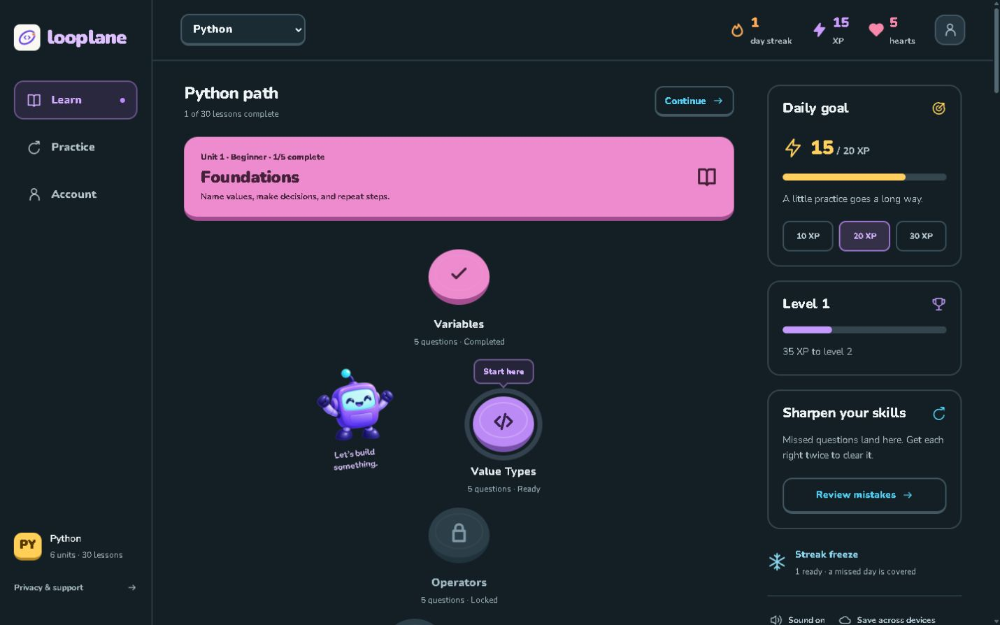

# LoopLane

A mobile-first coding app with JavaScript, Python, Java, and C++ paths, beginner-to-expert DSA lessons, and offline progress.

**[Open the live app](https://looplane-jogger.vercel.app/)** · **[Privacy policy](https://looplane-jogger.vercel.app/privacy)**



## Overview

LoopLane turns programming fundamentals and data structures and algorithms into short, interactive practice sessions. Choose a language, follow its sequential path, and revisit mistakes. Start as a guest or connect an account to sync progress across devices.

The curriculum includes **4 languages, 26 units, 125 lessons, and 627 questions**, including two JavaScript coding exercises.

## Features

- **Interactive lessons:** multiple choice, fill-in-the-blank, code reordering, output prediction, and in-browser coding exercises.
- **Language paths:** switch between JavaScript, Python, Java, and C++; each has independent lesson prerequisites and scoped mistake practice.
- **Learning progress:** shared XP, levels, hearts, local-calendar-day streaks, and daily goals of 10, 20, or 30 XP. Your selected language is saved.
- **Practice and recovery:** five hearts with timed regeneration, perfect-run bonuses, mistake review, and streak freezes.
- **Local-first learning:** guest progress is saved on the device; optional Supabase accounts add email/Google sign-in and cloud sync with retry behavior.
- **Offline support:** installable PWA with cached app files, curriculum, and feedback sounds after an initial online load.
- **Original interface:** a responsive midnight-plum design (`#19172e`), custom coding mascot, keyboard focus states, and reduced-motion support.
- **Sharing previews:** Open Graph and Twitter metadata with an original 1200×630 preview image and accurate curriculum details.
- **Question feedback:** “Report a problem” opens an editable email draft with the lesson and question identifiers; you review it before sending.
- **Privacy-aware traffic counts:** Vercel Web Analytics' free tier provides aggregate production page views. The integration honors Do Not Track and Global Privacy Control, removes URL query strings and fragments, and sends no learner code, answers, account details, or progress.

## Curriculum

| Language | Units | Lessons | Questions | Source |
| --- | ---: | ---: | ---: | --- |
| JavaScript | 8 | 35 | 177 | [lessons.json](src/data/lessons.json) |
| Python | 6 | 30 | 150 | [python.json](src/data/python.json) |
| Java | 6 | 30 | 150 | [java.json](src/data/java.json) |
| C++ | 6 | 30 | 150 | [cpp.json](src/data/cpp.json) |

Each path starts with language-specific foundations, then advances through these DSA units with examples in that language:

| Difficulty | Unit | Topics |
| --- | --- | --- |
| Intermediate | Complexity & Search | Big O, linear and binary search, two pointers, sliding windows |
| Advanced | Data Structures | Stacks, queues, linked lists, trees, hash maps |
| Advanced | Algorithms | Merge sort, BFS, DFS, heaps, greedy algorithms |
| Expert | Expert DSA | Memoization, tabulation, Dijkstra, disjoint sets, tries |

Every added lesson contains five questions and a concept/example reference. The original JavaScript Functions lesson retains seven questions, including two coding exercises. Completing a lesson unlocks the next lesson in that language. XP levels remain shared and increase every 50 XP.

The new languages use guided code reading, output prediction, fill-in-the-blank, and reorder exercises. **Executable learner-code exercises are JavaScript-only.** Python examples target Python 3, Java examples Java 17, and C++ examples C++17. All four courses are included in the offline cache.

## Tech stack

| Layer | Technology |
| --- | --- |
| Frontend | React, JavaScript / JSX |
| Build tooling | Vite |
| Styling | Tailwind CSS and custom CSS |
| Animation | Framer Motion |
| Optional authentication and database | Supabase |
| Offline support | vite-plugin-pwa / Workbox |
| Hosting | Vercel |
| Aggregate page-view analytics | Vercel Web Analytics |
| Tests | Node.js test runner |

## Getting started

### Requirements

- Node.js **22.12 or later**
- npm
- Git

### Run locally

```bash
git clone https://github.com/rishirana463-hub/LoopLane.git
cd LoopLane
npm ci
npm run dev
```

Open the local URL printed by Vite. **Guest mode works without Supabase credentials.**

### Available commands

| Command | Purpose |
| --- | --- |
| npm run dev | Start the development server |
| npm test | Run the automated tests |
| npm run build | Generate the production app in dist |
| npm run preview | Preview the production build locally |

To test installability and offline caching, use a production build. The service worker is disabled in the development server.

## Optional accounts and cloud sync

1. Create your own Supabase project.
2. Apply [supabase/schema.sql](supabase/schema.sql) in its SQL editor.
3. Copy [.env.example](.env.example) to .env.local.
4. Configure these two public client values:

```dotenv
VITE_SUPABASE_URL=
VITE_SUPABASE_ANON_KEY=
```

VITE_SUPABASE_ANON_KEY accepts the project's publishable key or legacy anon key. Never use a service-role key, secret key, database password, or OAuth client secret in the frontend.

5. Configure the desired authentication providers and email delivery in Supabase.
6. Set the Auth Site URL to your deployed app and allow its exact redirect URL. For local development, allow http://127.0.0.1:5173/ and http://localhost:5173/.
7. For Google sign-in, add your project's Supabase callback URL to the Google OAuth client's authorized redirect URIs:

```text
https://YOUR_PROJECT_REF.supabase.co/auth/v1/callback
```

Keep the Google client secret in Supabase's provider settings. Restart Vite after changing local environment values, or rebuild the production app.

The progress table uses Row Level Security to limit authenticated users to their own row. Without account configuration, the app continues to work in guest mode.

## Coding exercises

Learner code runs locally in a short-lived Web Worker inside an isolated browser frame. Each run has a two-second timeout, reports test results, and captures console output.

Learner code is not sent to Supabase or executed on an application server.

## Project structure

```text
src/
  components/          Reusable screens and UI components
  data/*.json         Language curricula (course → units → lessons → questions)
  lib/
    curriculum.js      Course catalog and language-scoped helpers
    progress.js        Pure game and progress rules
    useProgress.js     Local persistence and account sync
    codeRunner.js      Isolated browser code runner
public/                Icons and local feedback sounds
supabase/schema.sql    Progress table and access policies
tests/                 Automated regression tests
docs/screenshots/      README screenshots
vite.config.js         Build and PWA configuration
vercel.json            SPA routing configuration
```

## Testing

Automated tests cover progress rules, streak boundaries, independent language unlocking, selection persistence, curriculum schemas and answers, code-runner lifecycle, sandbox policy and timeouts, feedback audio, sharing metadata, question-report drafts, and analytics privacy filtering. Python and Java curriculum snippets were also executed locally during authoring. C++ has not been compiler-verified; independent educational content review remains important.

```bash
npm test
npm run build
```

Keep browser and physical-device checks alongside automated testing, especially for installation, offline reopening, sound, and authentication redirects.

## Deploy to Vercel

Import the repository into Vercel and use:

| Setting | Value |
| --- | --- |
| Framework | Vite |
| Build command | npm run build |
| Output directory | dist |

Add VITE_SUPABASE_URL and VITE_SUPABASE_ANON_KEY only if accounts and cloud sync are required. Configure the corresponding production Auth URLs in Supabase. The included vercel.json rewrites application routes to index.html so direct links and refreshes work.

Enable Web Analytics in the Vercel project dashboard to view aggregate traffic. Analytics runs only on the configured production hostname and public page views; it does not track lesson actions. If deploying under another hostname, update the production hostname in src/lib/analytics.js and the canonical/share URLs in index.html.

## Contributing

Open an issue to discuss a proposed change, or submit a focused pull request. Keep lesson content in the JSON curriculum, preserve the browser-only code runner, and run the tests and production build before submitting.

## Support

For support or account-deletion requests, contact **[rishirana463@gmail.com](mailto:rishirana463@gmail.com)**. See the [privacy policy](https://looplane-jogger.vercel.app/privacy) for details about local and synced progress.

Use **Report a problem** below any question to prepare an email with its context. Looplane never sends this report automatically.
